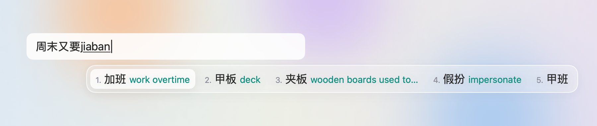

# 边打边学 · Zh2En

> 打中文的时候，顺手学地道英文。一个 macOS 输入法插件，外加一个玻璃浮窗。


## 它做什么

- **选字时**：候选词后面带英文释义，比如 `加班 work overtime`、`靠谱 reliable`。完全离线。
- **打句子时**：屏幕下方的玻璃浮窗实时显示整句英文（苹果系统翻译，离线、免费）。
- **打完一句**（可选）：接入 DeepSeek，补一句母语者在同样场合真正会说的话，再讲一个值得记的说法。

```
今天加班加到吐了。
I worked overtime today until I vomited.        ← 系统直译：准，但太直
✦ I'm so done with overtime today.              ← 地道版
so done = 受够了、累到不行                        ← 值得记的说法
```



<sub>示意图：候选顺序来自雾凇拼音的真实词频，英文是本项目词典的真实释义；实际外观取决于你的鼠须管皮肤（`./install.sh --theme` 就是图里这种清透样式）。</sub>

## 两种用法

|  | 只用系统翻译（默认） | 加上 DeepSeek 地道版 |
|---|---|---|
| 需要配置什么 | 什么都不用配 | 一个 DeepSeek API key |
| 联网 | 完全离线 | 每打完一句发一次 |
| 花费 | 免费 | 很少：一天 100 句，大约 0.015 美元 |
| "我先摸会儿鱼" | I'll touch the fish for a while…（翻车） | I'm gonna slack off for a bit. |

配了 key 以后，浮窗右上角会多一个「本地 / DeepSeek」开关，随时切换。

## 安装

需要：**macOS 26 或更新**，以及苹果命令行工具（没有的话先运行 `xcode-select --install`）。

```bash
git clone https://github.com/HeartY1ng/zh2en.git
cd zh2en
./install.sh
```

安装脚本会依次：

1. 检查环境。**没有鼠须管（Rime）或雾凇拼音，就问你要不要自动安装。**两样都从官方 GitHub 下载；鼠须管的安装包会先校验苹果签名和公证，不通过就停下，什么都不装。
2. 下载 [CC-CEDICT](https://www.mdbg.net/chinese/dictionary?page=cc-cedict)，在你电脑上生成一份精简的英文词典。
3. 往 `~/Library/Rime` 里**新增**几个文件，雾凇的原文件一个都不改。如果你已经有自己的 `rime_ice.custom.yaml`，脚本不碰它，只告诉你要加哪两行。
4. 编译浮窗小程序，装到 `~/Applications/Zh2En.app`。
5. 问你要不要配置 DeepSeek key。不配就只用系统翻译。

每一步都会先记进安装清单 `.installed`，卸载时只删清单里的东西。

- 想先看看会做什么：`./install.sh --dry-run`
- 想要截图里那种清透的横排候选框：`./install.sh --theme`

装完以后：

1. 输入法切到「鼠须管」。第一次使用会部署十几秒。
2. 下载系统翻译语言包：**系统设置 → 通用 → 语言与地区 → 翻译语言**，下载「中文（简体）」和「英语」。
3. 打一句「今天加班加到吐了。」

只想先看看浮窗长什么样：`open -n ~/Applications/Zh2En.app --args --demo`

### 配置 DeepSeek（可选）

1. 到 [DeepSeek 开放平台](https://platform.deepseek.com) 注册、充值、创建 API key。建议只充少量余额。
2. 在终端运行下面这条命令，把 key 粘贴进去（屏幕上不会显示），然后回车：
   ```bash
   security add-generic-password -U -s zh2en -a deepseek -w
   ```
3. 不用重启，下一句就生效。

key 只存在 macOS 钥匙串里，不写进任何文件。默认用 `deepseek-flash`，并关掉了模型的"思考"，否则又慢又贵。

### 换成别的模型

只要是 OpenAI 兼容接口都可以。新建 `~/.config/zh2en/config.json`，比如改用本地的 [Ollama](https://ollama.com)：

```json
{"baseURL": "http://localhost:11434/v1", "model": "qwen3:8b", "keychainAccount": ""}
```

`keychainAccount` 留空表示不需要 key。

## 用法

- **浮窗**：第一行是你正在打的中文，第二行是系统直译，一句话打完后滑进来 ✦ 地道版和要点，几秒后自动淡出。
- **点浮窗外面任意地方，它就收起来**。之后接着打字，浮窗只显示新打的部分。话打到一半停下，10 秒后也会自己收起。
- **挡视线就拖走**：按住浮窗任意位置，拖到你顺手的地方。它会记住位置，下次就在那里出现；菜单里的「浮窗回到默认位置」可以复原。
- **右上角开关**：「本地」只用系统翻译，一个字都不往外发；「DeepSeek」在一句话打完时发一次。如果一句话打完时用的是本地，切到 DeepSeek 会立刻补上这句的地道版。
- **菜单栏的对话气泡图标**：暂停翻译、开关地道版、浮窗回到默认位置、查看最近状态、退出。
- **Esc**：这句作废，从头开始。

## 隐私

| 数据 | 去了哪里 |
|---|---|
| 正在打的中文 | 只在本机：鼠须管 → 系统临时目录里的一个小文件 → 浮窗。浮窗收起就删。 |
| 系统直译 | 苹果系统翻译，完全离线 |
| 打完的一句话 | **只有在 DeepSeek 模式下**才发给 `api.deepseek.com` |
| **永远不发送** | 不含中文的内容（英文模式下打的密码、命令、验证码）；含 5 位以上数字、邮箱、网址，或"密码 / 验证码 / 身份证 / 银行卡 / 账号 / 地址"这类词的句子 |
| 硬盘 | 不保存任何句子。程序日志只记事件（比如"拿到地道版 0.7 秒"），不记内容。 |
| 屏幕共享 | 浮窗默认不出现在截图、录屏和屏幕共享里（个别软件可能仍能录到） |
| API key | macOS 钥匙串，服务名 `zh2en` |

切到别的输入法以后，这个项目就什么都看不到了。

## 原理

```
你按键 ──▶ 鼠须管（Rime）
             ├─ 雾凇拼音：拼音 → 候选词
             ├─ english_hint.lua：给每个候选词加上英文释义 ──▶ 候选框：加班 work overtime
             └─ sentence_tap.lua：只看、不拦截任何按键，记下"这句话打到哪了"
                        │  写进系统临时目录：zh2en/live.json
                        ▼
Zh2En.app（菜单栏小程序）  文件变了由系统通知，闲着时不耗电
   ├─ 停顿 0.25 秒 → 苹果系统翻译（离线）→ 浮窗第二行
   └─ 一句话打完 → DeepSeek → ✦ 地道版 + 要点
```

更细的说明（词典怎么清洗、提示词怎么写、踩过的坑）见 [docs/how-it-works.md](docs/how-it-works.md)。

## 卸载

```bash
./uninstall.sh        # 先预演：列出会做什么
./uninstall.sh --yes  # 真正执行
```

按安装清单倒序撤销，删除的东西都进废纸篓。鼠须管、雾凇如果是安装脚本帮你装的，会问你要不要一起删；你自己原来装的，一律不动。

## 常见问题

**浮窗不出现**
确认当前输入法是「鼠须管」，方案是雾凇拼音（按 `` Ctrl+` `` 切换方案）；再看看菜单栏的气泡图标是不是暂停了。

**只有直译，没有地道版**
看浮窗右上角是不是切到了「本地」。没配 key 时不会出现这个开关。具体出错原因可以看菜单第二行。

**没有直译**
系统翻译语言包还没下载，见上面的"装完以后"第 2 步。

**候选词后面没有英文**
在鼠须管菜单里点「重新部署」。

**输入法列表里没有鼠须管**
注销再登录一次。

**粘贴的文字、用鼠标改过的字，浮窗跟不上**
浮窗只看得到用鼠须管打的字。对不上的时候按 Esc 重来。

**我用的不是雾凇，是别的 Rime 方案**
把 `rime/rime_ice.custom.yaml` 里的那两项，加进你方案的 `<方案名>.custom.yaml`，然后重新部署。

## 已知局限

- 候选词后面的英文是词典释义，偏字面（比如"内卷 → involute"）。地道的说法要看整句。
- 浮窗不会自动跟着光标走（可以手动拖到任何位置）。
- 需要在自己电脑上编译。没有开发者签名的预编译版本，因为苹果会拦下未公证的 app。

## 致谢与许可

- 本项目代码：[MIT](LICENSE)
- [CC-CEDICT](https://www.mdbg.net/chinese/dictionary?page=cc-cedict)（MDBG，CC BY-SA 4.0）：安装时下载，在你电脑上生成精简词典；本仓库不分发词典数据。
- [鼠须管 Squirrel](https://github.com/rime/squirrel) / [Rime](https://rime.im)（GPL-3.0）、[雾凇拼音 rime-ice](https://github.com/iDvel/rime-ice)（GPL-3.0）：安装时从官方下载；本仓库不包含它们的代码。
- 苹果 Translation 框架；[DeepSeek API](https://api-docs.deepseek.com)。
